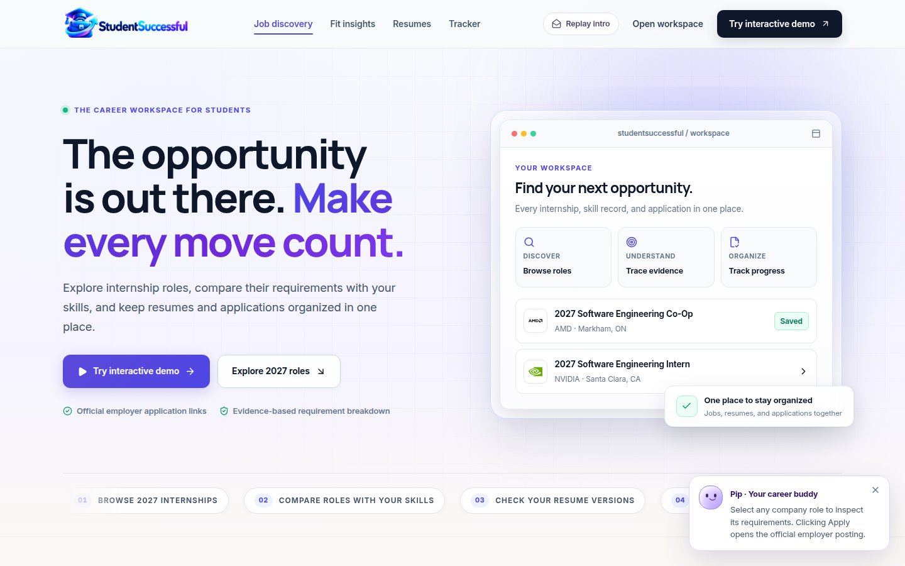
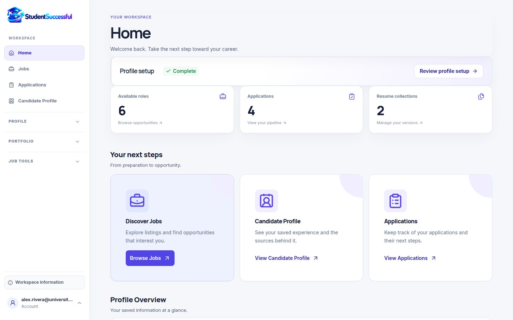
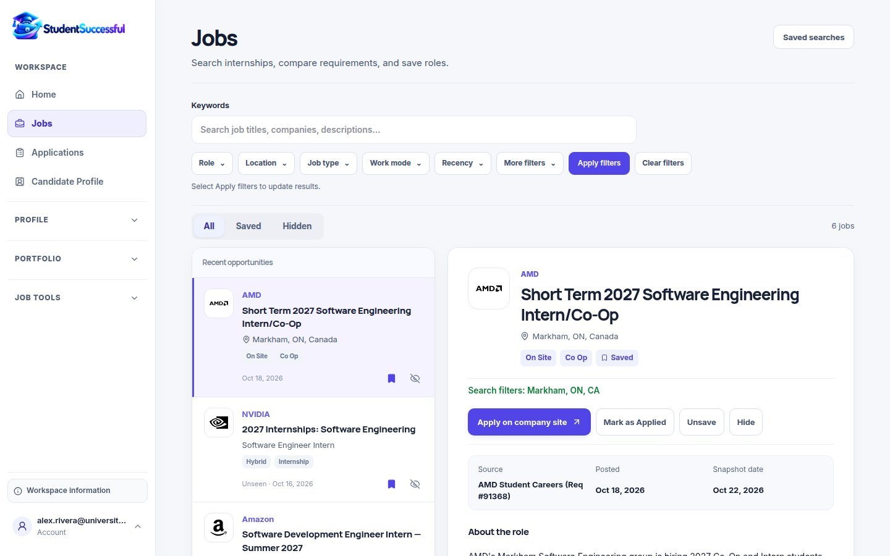
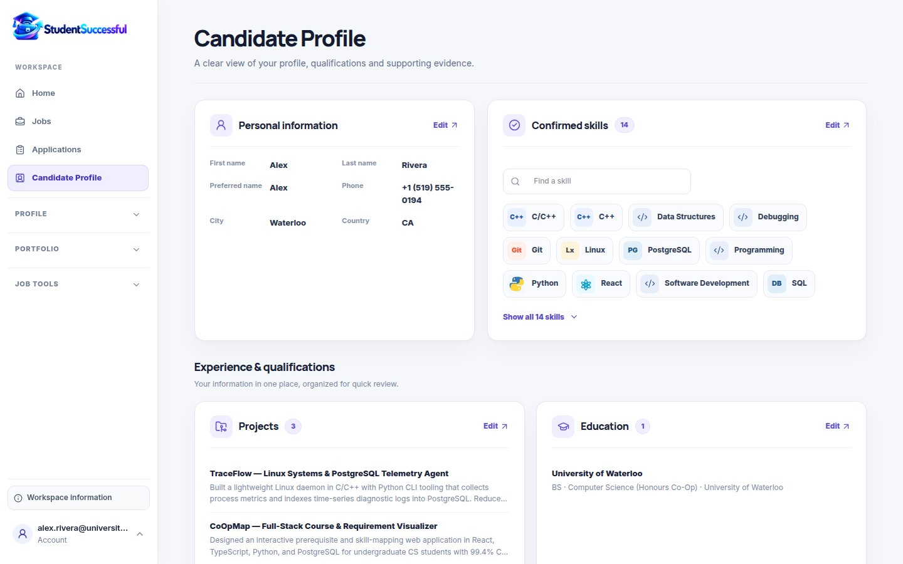
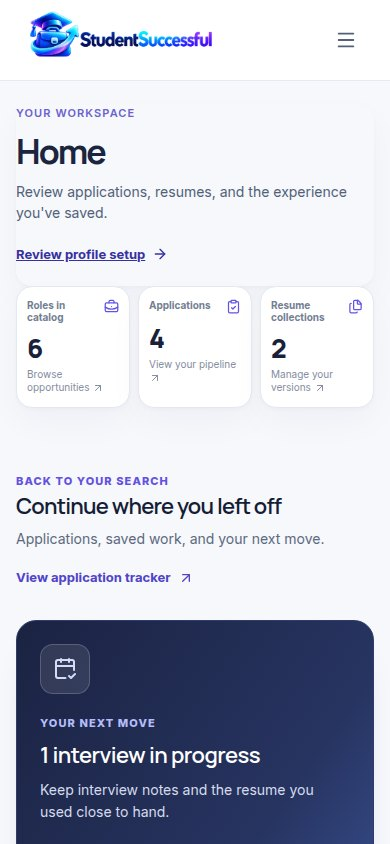

<div align="center">
  

  # StudentSuccessful

  **Find opportunities. Understand your fit. Keep your career search organized.**

  A student career workspace for discovering internships, comparing job requirements with your experience, managing resumes, and tracking applications.

  **[Live website](https://studentsuccessful.vercel.app/)** · **[Explore the workspace](https://studentsuccessful.vercel.app/demo)**
</div>

## What you can do

- **Discover jobs:** search and filter internships, review requirements, and open employer career pages.
- **Understand your fit:** compare your confirmed skills and resume evidence with a role's requirements.
- **Improve your resume:** manage resume versions and review alignment with a selected job.
- **Track applications:** save roles, organize applications, and update their status.
- **Build your profile:** keep education, projects, employment, skills, and career preferences together.

## One connected workflow

**Browse → Compare → Prepare → Track.**

1. Browse internship roles and examine the stated requirements.
2. Compare requirements against skills, projects, and resume evidence recorded in your profile. Missing evidence is **not** a judgment of your ability.
3. Manage resume versions and review the suggestions associated with a selected role.
4. Record your application and revisit its status, notes, and resume.

This is the core interaction the redesigned dashboard now emphasizes: the next useful action, not just a list of features.

## Screenshots

Screenshots are captured from the running Next.js application at desktop and mobile sizes, not design mockups. The screenshot workflow checks route rendering and selected interactions before updating these images.

| Landing page | Career workspace |
|:--:|:--:|
|  |  |
| Job discovery | Candidate profile |
|  |  |




## Try it online

1. Open **[studentsuccessful.vercel.app](https://studentsuccessful.vercel.app/)**.
2. Choose **Try interactive demo** to enter the workspace without creating an account.
3. Explore Jobs, Resumes, Candidate Profile, and Applications.

On mobile, open the navigation menu to move between pages and access account controls.

The public showcase uses illustrative student records stored in your browser. It does **not** submit real job applications or create real accounts. Employer links are external; check posting details on the employer's website.

## Run the frontend locally

**Requirements:** Node.js 22.13+ (Node 22) and npm.

```bash
cd frontend
npm ci
```

Enable the frontend-only workspace, then start Next.js:

```bash
# macOS / Linux
NEXT_PUBLIC_DEMO_MODE=true npm run dev
```

```powershell
# Windows PowerShell
$env:NEXT_PUBLIC_DEMO_MODE="true"
npm run dev
```

Open **http://localhost:3000**. No database or Python backend is needed in this mode.

## Tech stack

| Layer | Technology |
| --- | --- |
| Frontend | Next.js 15, React 19, TypeScript, CSS |
| Backend | FastAPI, SQLAlchemy, Alembic |
| Database | PostgreSQL 16 |
| Testing | Vitest, Playwright, Pytest, GitHub Actions |
| Deployment | Vercel (frontend showcase), Docker Compose (local full stack) |

The repository supports two setups: a **frontend-only showcase** with browser-local state, and a **full-stack application** that uses FastAPI and PostgreSQL with real authentication. The public Vercel showcase currently uses the first setup.

## Run the full stack

Install Docker Desktop / Docker Engine with Compose v2. From the repository root:

```powershell
# Windows PowerShell
Copy-Item .env.example .env

docker compose up --build
```

For macOS / Linux, use `cp .env.example .env` instead. Then visit `http://localhost:3000` (app) or `http://localhost:8000/docs` (API documentation). Configure the `.env` values for your own environment; never commit credentials.

## Check the code

From `frontend/`:

```bash
npm run lint
npm run type-check
npm run test
npm run build
```

GitHub Actions also checks the backend, database migrations, API contract, and browser authentication flow.

## Project structure

```text
frontend/        Next.js website and interactive workspace
backend/         FastAPI application and database models
docs/            Engineering notes and screenshots
scripts/         Development and verification tools
.github/         CI workflows
```

For technical implementation details, see [engineering documentation](docs/) and the [engineering history](docs/engineering-history.md). The [UX/content review](docs/ux-content-audit.md) records the design decisions and remaining manual checks.

### Screenshot maintenance

The [README screenshot workflow](.github/workflows/readme-screenshots.yml) renders the actual frontend in a browser and refreshes the images when this README changes. It can also be started manually from GitHub Actions. Images are captured using the browser installed on the GitHub runner.
